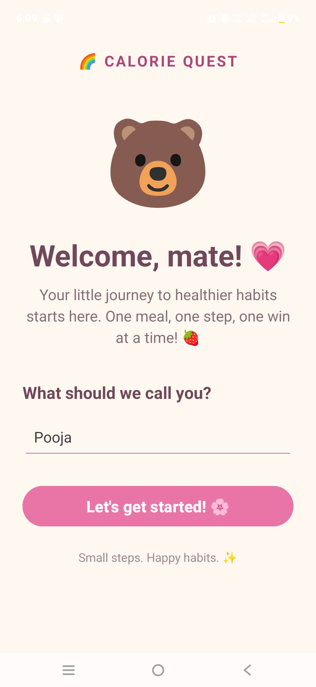
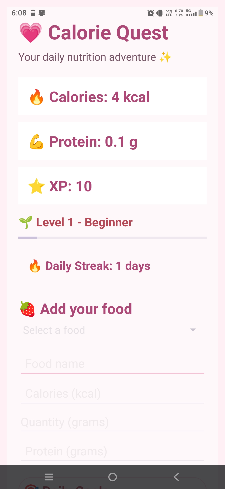
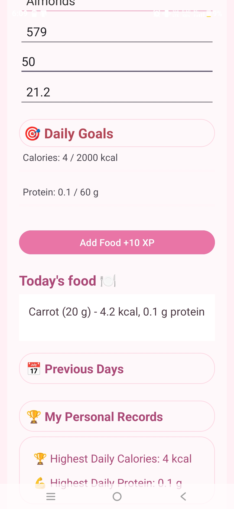

**🍓 Calorie Quest**

Your daily nutrition journey, made simple and fun!

Calorie Quest is an Android nutrition-tracking application built with Java. It helps users track their daily calorie and protein intake, review previous food logs, and stay motivated through streaks and levels.

✨ Features

- 🍎 Food Tracking — Manually record food items, quantities, calories, and protein.
- 📊 Daily Nutrition Goals — View your daily calorie and protein intake.
- 📅 Food History — Review food entries from previous dates.
- 🏆 Personal Records — Track your highest daily calorie and protein intake.
- 🔥 Streaks and Levels — Stay motivated as you progress.
- 💾 Local Data Storage — Save nutrition data on the device.

🛠️ Tech Stack

- Language: Java
- Platform: Android
- IDE: Android Studio
- UI: XML layouts
- Local Storage: SharedPreferences

🚀 Getting Started

1. Clone this repository.
2. Open the project in Android Studio.
3. Allow Gradle to sync.
4. Run the app on an Android device or emulator.

🎯 Project Goal

To make daily nutrition tracking accessible, engaging, and easy to maintain through a simple Android application.

👩‍💻 Developer

Built as a personal Android development project while learning Java and app development.

---

## 📱 App Screenshots

### 🧸 Welcome Screen

### 🍓 Calorie Quest Dashboard

### 🏆 Nutrition Tracking

---

Made with 💗 and a little bit of code.
